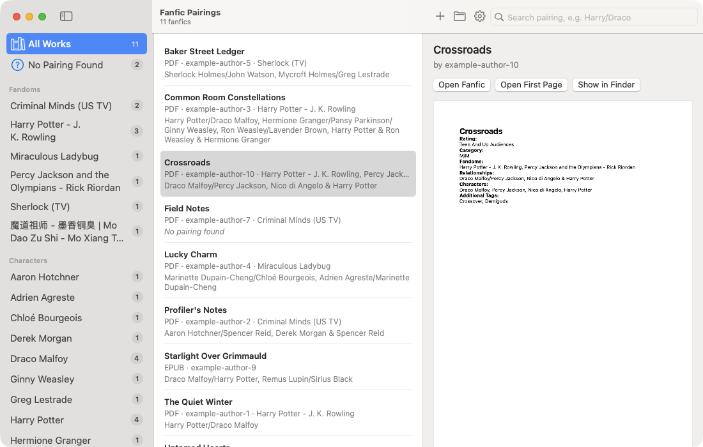

# Fanfic Pairings

A small, fully offline Mac app that sorts your downloaded fanfiction by **pairing**, **character** and **fandom**.

Give it the EPUB or PDF files you downloaded (for example from AO3). It reads the *Relationship* and *Fandom* fields on each work's first page, keeps a copy of the work and of its first page, and lets you find everything again by pairing — `Harry/Draco`, `Draco/Harry`, `harry / draco` or just `Draco` all work.



## Features

- **Import** EPUB and PDF files by dragging them (or whole folders) onto the window or the Dock icon, with **Add Files…**, or with Finder's *Open With*. A summary shows what was added, skipped or could not be read.
- **First-page copies**: the first page of every work is saved as its own one-page PDF, so you can see a work's tags at a glance.
- **IDs and lists**: every work and every first-page copy gets its own ID. `library.json` lists all works, pairings, characters and fandoms with those IDs — readable by hand.
- **Search by pairing**: order, spacing, upper/lower case and accents don't matter; part of a name works if it is the start of a word (`Hotch/Reid` finds *Aaron Hotchner/Spencer Reid*, and `Ron` does not find *Aaron*). Poly pairings and friendship tags (`A & B`) are understood.
- **Browse** by fandom (crossovers count in every fandom they list), by character or by pairing in the sidebar.
- **Settings** to show, hide and sort the sidebar lists and to leave friendship tags out.
- **Fast with big libraries**: about a second to open and a few hundredths of a second per search at 10,000 fanfics.
- **Private**: no internet access, no accounts, no analytics. Everything stays on your Mac.

## Requirements

- macOS 15 or later (developed and tested on macOS 27, Apple Silicon)
- To build it: Xcode 16 or later, or its Command Line Tools (`xcode-select --install`)
- Windows or Linux: see [Windows and Linux (Alpha)](#windows-and-linux-alpha)

## Install

There is no ready-made download yet; the app is built from source in one step:

```sh
git clone https://github.com/lumierecoding/fanfic-pairings.git
cd fanfic-pairings
./scripts/build-app.sh
```

The script builds the app, signs it for your Mac (ad-hoc, no Apple account or password needed) and installs it as `/Applications/Fanfic Pairings.app`. Build it on each Mac you want to use it on: a copy of the built app moved to another Mac is blocked by macOS because it isn't notarized.

## Quick start

1. Open **Fanfic Pairings** from Applications or Spotlight.
2. Drag a few downloaded fanfics (EPUB or PDF) onto the window.
3. Type a pairing into the search field at the top right, or open **Fandoms**, **Characters** or **Pairings** in the sidebar by clicking their names.

The [user manual](docs/USER_MANUAL.md) explains everything in detail.

## Windows and Linux (Alpha)

There is also a version for **Windows and Linux**, written in Python with Qt, in [`desktop/`](desktop/README.md). It reads files exactly like the Mac app and uses the same library format.

> **Alpha — not tested on Windows or Linux.** It is developed and tested on macOS only. Please report problems.

Install it with `uv tool install "git+https://github.com/lumierecoding/fanfic-pairings#subdirectory=desktop"` (or `pipx install …`) — details in [desktop/README.md](desktop/README.md).

## Documentation

- [User manual](docs/USER_MANUAL.md) — importing, searching, the sidebar, Settings, where your files are, troubleshooting
- [Specification](SPEC.md) — exactly how files are read, what `library.json` contains and how search works
- [Development](docs/DEVELOPMENT.md) — building, tests, test files, project layout
- [Changelog](CHANGELOG.md)

## Privacy

Fanfic Pairings has no network code and links no networking libraries; it cannot connect to the internet. It only reads files you give it and writes into its own library folder (`~/Library/Application Support/Fanfic Pairings`) and its preferences. Nothing is uploaded or shared.

## Not affiliated

Fanfic Pairings is an independent project. It is not affiliated with or endorsed by the Archive of Our Own (AO3) or the Organization for Transformative Works. It never downloads anything: it only reads files you have already saved. Please support the authors whose work you read.

## License

[MIT](LICENSE)
