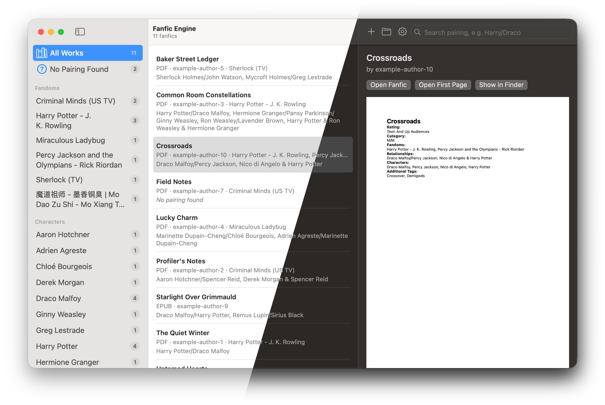

<p align="center">
  
</p>

<h1 align="center">Fanfic Engine</h1>

A small, fully offline Mac app that sorts your downloaded fanfiction by **pairing**, **character** and **fandom**.

Give it the EPUB or PDF files you downloaded (for example from AO3). It reads the *Relationship* and *Fandom* fields on each work's first page, keeps a copy of the work and of its first page, and lets you find everything again by pairing — `Harry/Draco`, `Draco/Harry`, `harry / draco` or just `Draco` all work.



<p align="center">
  <a href="https://github.com/lumierecoding/fanfic-engine/releases/latest"><b>Download for Mac</b></a> · free and open source · works offline
</p>

## A folder full of fics and no idea which file is which?

When AO3 went offline at the end of October 2026 after a security incident, with no return expected for weeks, a lot of us suddenly had only the fics we had downloaded over the years. I had hundreds of them and no idea which file was what. Fans started sharing their downloaded collections with each other, and those folders are often just as unsorted, with the same fic in them more than once.

That is why I made Fanfic Engine. Drop your whole fic folder onto the window, and a few seconds later you can browse it the way you would on AO3:

- **Find a pairing**: type `Harry/Draco`, `Draco/Harry` or just `Draco`.
- **Browse by fandom and character**, crossovers included.
- **Exact duplicates are skipped**, so a file that's in two shared folders only shows up once.
- **No internet needed**: it works when the archive is down, and nothing you import ever leaves your computer.
- **Free**, for Mac, with an alpha version for Windows and Linux.

If you share or receive fics while AO3 is down, please respect the authors' wishes: many writers don't want their work re-posted elsewhere. When the archive is back, leave kudos and comments on the originals. Fanfic Engine only sorts files on your own computer and never shares anything.

If it helps you, a ⭐ on this page helps other fans find it.

## Features

- **Import** EPUB and PDF files by dragging them (or whole folders) onto the window or the Dock icon, with **Add Files…**, or with Finder's *Open With*. A summary shows what was added, skipped or could not be read.
- **First-page copies**: the first page of every work is saved as its own one-page PDF, so you can see a work's tags at a glance.
- **IDs and lists**: every work and every first-page copy gets its own ID. `library.json` lists all works, pairings, characters and fandoms with those IDs — readable by hand.
- **Search by pairing**: order, spacing, upper/lower case and accents don't matter; part of a name works if it is the start of a word (`Hotch/Reid` finds *Aaron Hotchner/Spencer Reid*, and `Ron` does not find *Aaron*). Poly pairings and friendship tags (`A & B`) are understood.
- **Browse** by fandom (crossovers count in every fandom they list), by character or by pairing in the sidebar.
- **Settings** to show, hide and sort the sidebar lists and to leave friendship tags out.
- **Fast with big libraries**: about a second to open and a few hundredths of a second per search at 10,000 fanfics.
- **Private**: no internet access, no accounts, no analytics. Everything stays on your Mac.

## Requirements

- macOS 15 or later, Apple Silicon or Intel (developed and tested on macOS 27, Apple Silicon; the Intel version is built but not tested)
- Windows or Linux: see [Windows and Linux (Alpha)](#windows-and-linux-alpha)

## Download

1. Download **Fanfic-Engine-1.0.dmg** from the [Releases page](https://github.com/lumierecoding/fanfic-engine/releases).
2. Open it and drag **Fanfic Engine** onto **Applications**.
3. Open Fanfic Engine. Because the app is free and not notarized by Apple (that needs a paid developer account), macOS first says it *could not verify* the app. Click **Done**, then open **System Settings → Privacy & Security**, scroll down to *"Fanfic Engine" was blocked…* and click **Open Anyway** (confirm with your password or Touch ID). After that it opens normally.

   Terminal alternative: `xattr -dr com.apple.quarantine "/Applications/Fanfic Engine.app"`

The disk image also contains these steps as *Read Me First.txt*. To check the download, compare its SHA-256 (`shasum -a 256 Fanfic-Engine-1.0.dmg`) with `SHA256SUMS` on the release page.

## Build it yourself

Needs Xcode 16 or later, or its Command Line Tools (`xcode-select --install`):

```sh
git clone https://github.com/lumierecoding/fanfic-engine.git
cd fanfic-engine
./scripts/build-app.sh
```

The script builds the app, signs it for your Mac (ad-hoc, no Apple account or password needed) and installs it as `/Applications/Fanfic Engine.app`. An app you build yourself opens without the extra step above.

## Quick start

1. Open **Fanfic Engine** from Applications or Spotlight.
2. Drag a few downloaded fanfics (EPUB or PDF) onto the window.
3. Type a pairing into the search field at the top right, or open **Fandoms**, **Characters** or **Pairings** in the sidebar by clicking their names.

The [user manual](docs/USER_MANUAL.md) explains everything in detail.

## Windows and Linux (Alpha)

There is also a version for **Windows and Linux**, written in Python with Qt, in [`desktop/`](desktop/README.md). It reads files exactly like the Mac app and uses the same library format.

> **Alpha — not tested on Windows or Linux.** It is developed and tested on macOS only. Please report problems.

Install it with `uv tool install "git+https://github.com/lumierecoding/fanfic-engine#subdirectory=desktop"` (or `pipx install …`), or from the `.whl` file on the [Releases page](https://github.com/lumierecoding/fanfic-engine/releases). It needs Python 3.10 or newer; there is no stand-alone Windows or Linux app yet. Details in [desktop/README.md](desktop/README.md).

## Documentation

- [User manual](docs/USER_MANUAL.md) — importing, searching, the sidebar, Settings, where your files are, troubleshooting
- [Specification](SPEC.md) — exactly how files are read, what `library.json` contains and how search works
- [Development](docs/DEVELOPMENT.md) — building, tests, test files, project layout
- [Changelog](CHANGELOG.md)

## Privacy

Fanfic Engine has no network code and links no networking libraries; it cannot connect to the internet. It only reads files you give it and writes into its own library folder (`~/Library/Application Support/Fanfic Engine`) and its preferences. Nothing is uploaded or shared.

## Not affiliated

Fanfic Engine is an independent project. It is not affiliated with or endorsed by the Archive of Our Own (AO3) or the Organization for Transformative Works. It never downloads anything: it only reads files you have already saved. Please support the authors whose work you read.

## License

[MIT](LICENSE)
