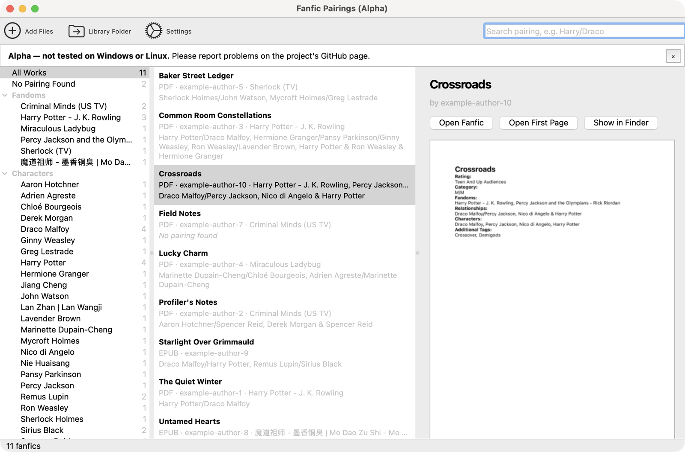

# Fanfic Engine for Windows and Linux — Alpha

> **Alpha — not tested on Windows or Linux.** This version is developed and tested on macOS only. It is written to work on Windows and Linux, but nobody has tried it there yet. Please [report problems](https://github.com/lumierecoding/fanfic-engine/issues).

The same app as the [Mac version](../README.md): it sorts your downloaded fanfiction (EPUB and PDF, for example AO3 downloads) by **pairing**, **character** and **fandom**, completely offline. This version is written in Python with Qt, so it can run on Windows and Linux. It reads files exactly like the Mac app (it is checked against the same test files) and uses the same library format.



## Requirements

- Windows 10/11 or a current Linux desktop (macOS works too)
- Python 3.10 or newer
- About 250 MB of disk space for Qt and PDFium

## Install

The easiest way is [uv](https://docs.astral.sh/uv/) (or [pipx](https://pipx.pypa.io/)), which installs the app with its own private copy of its libraries:

```sh
uv tool install "git+https://github.com/lumierecoding/fanfic-engine#subdirectory=desktop"
# or: pipx install "git+https://github.com/lumierecoding/fanfic-engine#subdirectory=desktop"
```

Then start it with:

```sh
fanfic-engine
```

No shortcut in the Start menu or app launcher is created yet (alpha).

Getting uv: on Windows `winget install astral-sh.uv`, on Linux `curl -LsSf https://astral.sh/uv/install.sh | sh` or your distribution's package.

Linux note (untested): Qt needs a few system libraries for its window system plugin. If the app does not start on Debian/Ubuntu, `sudo apt install libxcb-cursor0` usually fixes it.

**From the release page:** download the `.whl` file from the [Releases page](https://github.com/lumierecoding/fanfic-engine/releases) and run `uv tool install fanfic_engine-0.1.0a1-py3-none-any.whl` (or `pipx install …`) in the folder you saved it to. It still needs Python; a stand-alone Windows or Linux app doesn't exist yet.

**From a downloaded copy of the repository:**

```sh
cd desktop
uv run fanfic-engine
```

## Using it

Everything works like in the Mac app — see the [user manual](../docs/USER_MANUAL.md). The differences on Windows and Linux are in [its section 16](../docs/USER_MANUAL.md#16-windows-and-linux-alpha):

- the menu bar is inside the window (File, Help); Settings is **File → Settings…** (Ctrl+,) or the toolbar button;
- **Show in Explorer** (Windows) / **Show in Folder** (Linux) instead of Show in Finder;
- the number of listed fanfics is in the status bar at the bottom;
- a notice bar says that this is an alpha; × hides it until the next start.

**Library folder:** Windows `%APPDATA%\Fanfic Engine`, Linux `~/.local/share/Fanfic Engine` (or `$XDG_DATA_HOME/Fanfic Engine`). It has the same layout and `library.json` as the Mac app.

**Settings** are stored with Qt's `QSettings`: in the registry on Windows (`HKEY_CURRENT_USER\Software\Fanfic Engine`), in `~/.config/Fanfic Engine/Fanfic Engine.conf` on Linux.

## Privacy

The app has no network code and cannot connect to the internet. It reads only the files you give it and writes only into its library folder and its settings.

## Uninstall

```sh
uv tool uninstall fanfic-engine      # or: pipx uninstall fanfic-engine
```

To remove your library too, delete the library folder above (this deletes the copies of your fanfics and first pages, not your originals).

## Third-party software

This version uses, without changes:

- [Qt for Python (PySide6)](https://www.qt.io/qt-for-python), © The Qt Company, licensed under the **GNU LGPL v3**. It is installed as a separate package, so you can replace it with another compatible version.
- [pypdfium2](https://github.com/pypdfium2-team/pypdfium2) (Apache-2.0 / BSD-3-Clause) with [PDFium](https://pdfium.googlesource.com/pdfium/) (BSD-3-Clause), © Google and contributors.

The app itself is under the [MIT License](../LICENSE).

## For development

```sh
cd desktop
uv run pytest            # 53 tests on the shared ../Fixtures and crafted files, same expected results as the Mac app
uv run fanfic-engine --help
```

The developer launch options (`--library-path`, `--import`, `--search`, `--sidebar`, `--select-title`, `--appearance`, `--open-settings`, `--open-about`, `--preview-drop`, `--window-size`, `--set`) are described in `src/fanficengine/ui/app.py`. Always use `--library-path` with a test folder when experimenting, so your real library is never touched. Layout rules: [docs/ui-spec-desktop.md](../docs/ui-spec-desktop.md).
