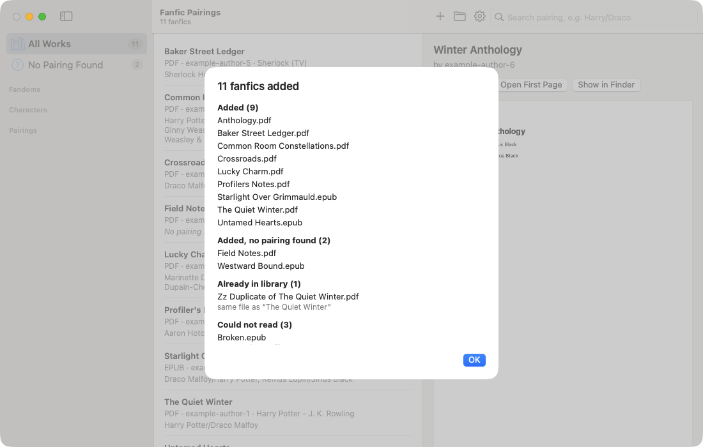
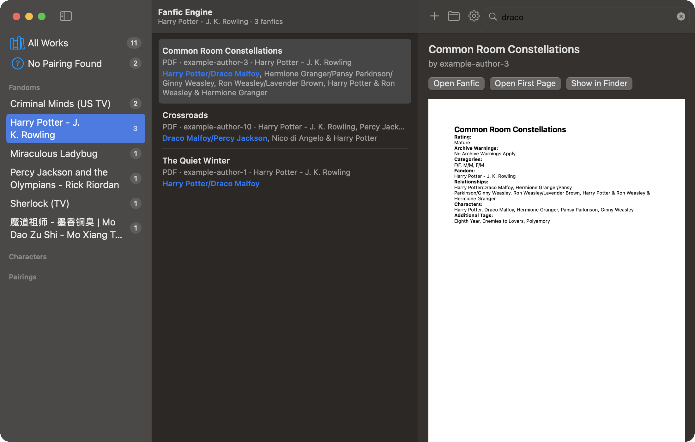
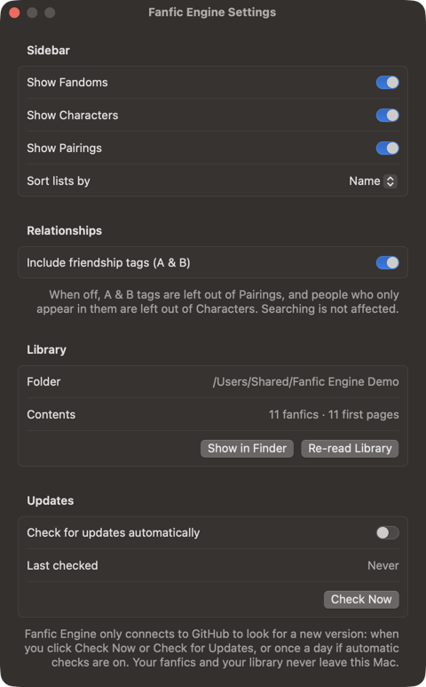
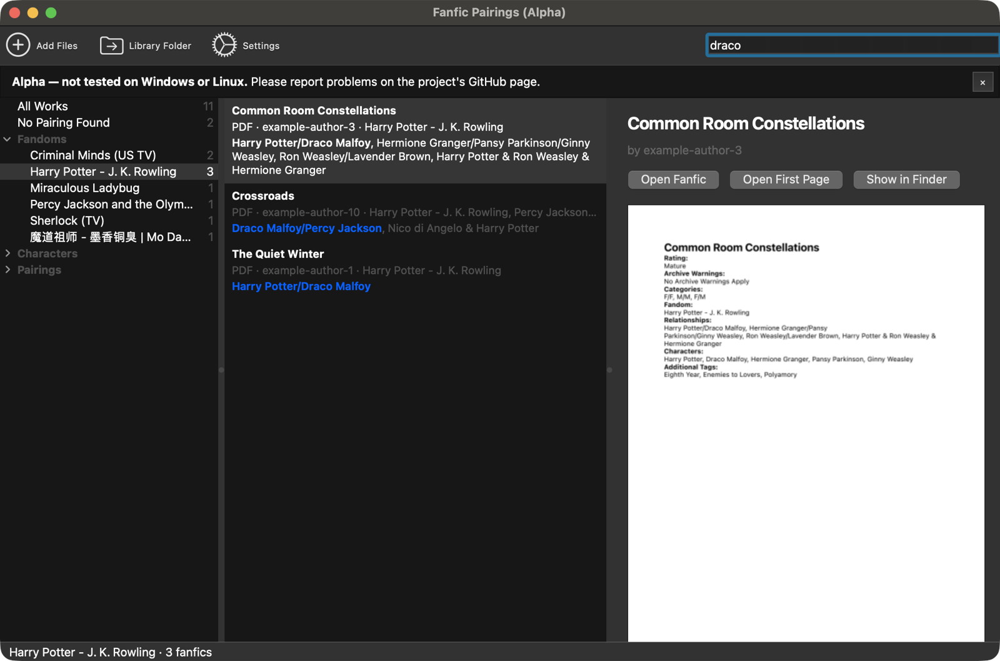

# Fanfic Engine — User manual

Fanfic Engine keeps a library of the fanfics you have downloaded and lets you find them by pairing, character and fandom. It works offline; the only thing that uses the internet is the update check, and only if you allow it (section 7 and 13).

![How Fanfic Engine works, in four steps. 1: you drag EPUB or PDF files, or whole folders, onto the window; your original files are never changed or moved. 2: the first page is saved as its own PDF and its Fandom and Relationship tags are read; A/B is a pairing, A & B a friendship. 3: a library folder keeps a copy of each fic, its first page and library.json; the same file is only added once, and every fic and first page gets its own ID. 4: you search a pairing in any order, or browse fandoms, characters and pairings, and click a fic to see its first page. Everything stays on your Mac.](images/how-it-works.png)

**Contents**

1. [Installing and opening the app](#1-installing-and-opening-the-app)
2. [Adding fanfics](#2-adding-fanfics)
3. [The window](#3-the-window)
4. [Searching](#4-searching)
5. [Browsing by fandom, character and pairing](#5-browsing-by-fandom-character-and-pairing)
6. [The details column](#6-the-details-column)
7. [Settings](#7-settings)
8. [Where your files are](#8-where-your-files-are)
9. [Duplicates](#9-duplicates)
10. [Removing works and re-reading the library](#10-removing-works-and-re-reading-the-library)
11. [Which files work best](#11-which-files-work-best)
12. [Big libraries](#12-big-libraries)
13. [Privacy](#13-privacy)
14. [Troubleshooting and questions](#14-troubleshooting-and-questions)
15. [Uninstalling](#15-uninstalling)
16. [Windows and Linux (alpha)](#16-windows-and-linux-alpha)

---

## 1. Installing and opening the app

Download the newest **Fanfic-Engine-….dmg** from the [Releases page](https://github.com/lumierecoding/fanfic-engine/releases), open it and drag **Fanfic Engine** onto **Applications**. (Or build it yourself, see the [README](../README.md#build-it-yourself).) It runs on macOS 15 or later.

**The first time you open a downloaded copy**, macOS says it *could not verify* "Fanfic Engine". That is because the app is not notarized by Apple (notarizing needs a paid developer account), not because something is wrong with it. To allow it once:

1. Click **Done** in that message.
2. Open **System Settings → Privacy & Security** and scroll down to *"Fanfic Engine" was blocked to protect your Mac*.
3. Click **Open Anyway** and confirm with your password or Touch ID.

From then on, open it like any other app: from Applications, Launchpad, the Dock or Spotlight (⌘ Space, type "Fanfic"). If you prefer Terminal: `xattr -dr com.apple.quarantine "/Applications/Fanfic Engine.app"` does the same.

**Updates** (from version 1.1): choose **Fanfic Engine → Check for Updates…**, or let the app check once a day; it asks on its second start whether it may. When a new version is there, click **Install Update**: the app downloads it, checks that it is signed by the project, replaces itself and opens again, without the *Open Anyway* step. Your library is not touched. Going from 1.0 to 1.1 is the one update you install by hand.

The first time it opens, the library is empty and the middle of the window says *"Drop EPUB or PDF files here, or click Add Files…"*.

## 2. Adding fanfics

There are four ways to add fanfics. All of them accept single files, several files, or whole folders (subfolders included):

- **Drag** files or folders onto the window. A blue outline shows while you drag.
- Click **+** in the toolbar, or choose **File → Add Files…** (⌘O), and pick files or folders.
- **Drop** files onto the app's icon in the Dock.
- In Finder, right-click a file → **Open With → Fanfic Engine**.

For each file the app:

1. checks whether exactly the same file is already in the library (see [Duplicates](#9-duplicates));
2. gives the work an ID, and its first-page copy another ID;
3. copies the file into the library, so it keeps working if you later move or delete the original;
4. saves a copy of the first page as a one-page PDF;
5. reads the **Relationship** and **Fandom** fields from that page, plus the title and author.

Your original file is never changed or moved.

When the import is done, a summary appears:



| Heading | Meaning |
| --- | --- |
| **Added** | Imported, with at least one pairing found |
| **Added, no pairing found** | Imported, but the first page has no Relationship field (for example a gen fic, or a file from a site that doesn't list relationships). It appears under **No Pairing Found** |
| **Already in library** | Exactly the same file was imported before; nothing is added |
| **Could not read** | Not a working PDF or EPUB, a password-protected PDF, or a scanned PDF without text. Nothing is kept |
| **Skipped** | Not a PDF or EPUB (only appears when you add folders) |

Click **OK** to close it.

## 3. The window

The window has three columns:

- **Sidebar (left)**: **All Works** and **No Pairing Found**, with counts, and below them three lists — **Fandoms**, **Characters** and **Pairings** — that start folded.
- **Works list (middle)**: every work that matches the current search or sidebar choice, sorted by title. Each row shows the title, the file type, the author, the fandom and the relationships. Relationships that match your search are highlighted.
- **Details (right)**: the selected work's summary and first page, its fandom(s), relationships, file name and IDs, with buttons to open it.

The toolbar has **+** (add files), the **folder** button (show the library in Finder), the **gear** (Settings) and the **search field**. The line under the window title says how many fanfics are listed.

## 4. Searching

Type into the search field at the top right. The list updates as you type.

| You type | You get works with … |
| --- | --- |
| `Harry/Draco` | a pairing with both Harry and Draco, in either order |
| `Draco/Harry`, `harry / draco`, `HarryPotter/DracoMalfoy` | the same: order, spaces and upper/lower case don't matter |
| `Draco` | Draco in any relationship (pairing or friendship) |
| `Harry & Ron` | a friendship tag with both (`Harry Potter & Ron Weasley`) |
| `Pansy/Hermione` | also poly pairings such as `Hermione Granger/Pansy Parkinson/Ginny Weasley` |
| `chloe` | `Chloé` — accents don't matter |
| (empty) | everything |

**Parts of names** work when they are the start of a word: `Hotch/Reid` finds *Aaron Hotchner/Spencer Reid*, `Dupain` finds *Marinette Dupain-Cheng*. Letters in the middle of a word don't count, so `Ron` does not find *Aaron* or *Veronica*. Names with alternatives, like AO3's `Lan Zhan | Lan Wangji`, are found by either name.

A search with `/` only finds pairings (romantic tags); a search with `&` only finds friendship tags; a single name finds both.

The search looks at the **Relationship** field only. Fandoms are browsed through the sidebar (next section); the separate *Characters:* field and other tags on the first page are not used.

## 5. Browsing by fandom, character and pairing

The three lists in the sidebar start folded. **Click a list's name** (or the small arrow that appears when you point at it) to open or fold it. The app remembers which lists you left open.

- **Fandoms** — every fandom in your library once, with the number of fanfics. **Click a fandom** to see only its works; the search field then searches *inside* that fandom, and the line under the title shows the fandom's name. A crossover (a work with several fandoms) is listed under each of them. Click **All Works** to leave the fandom.
- **Characters** — everyone who appears in a pairing or friendship tag, once each. **Click a character** to search for them (their name goes into the search field). This list is made from the relationship tags, not from the first page's separate *Characters:* field. Different spellings of the same name (case, accents, spacing) count as one; alternative names such as `Tom Riddle` and `Tom Riddle | Voldemort` stay separate entries. Because a name search also finds names that *start* with it, clicking `Tom Riddle` also finds works tagged `Tom Riddle | Voldemort`.
- **Pairings** — every pairing once. `A/B` and `B/A` are one entry, shown in the spelling used most often. **Click a pairing** to search for it.



## 6. The details column

Select a work in the middle column to see:

- its **summary**, as the author wrote it, under the buttons. It's read once when the work is added; long summaries are shown in full, and you can select and copy the text. A file without one shows *No summary found* (common for files from sites other than AO3);
- its **first page** (the saved copy);
- **Fandom(s)**, **Relationships**, the original **file** name and which page was used as the first page;
- the **Work ID** and **First-page ID** (you can select and copy them).

Buttons:

- **Open Fanfic** — opens the library's copy in your default app for that file type (for example Books for EPUB, Preview for PDF);
- **Open First Page** — opens the first-page copy;
- **Show in Finder** — shows the library's copy of the file.

The same commands, plus **Remove from Library…**, are in the right-click menu of every work in the middle column.

## 7. Settings

Open Settings with the **gear** button or **Fanfic Engine → Settings…** (⌘,).



- **Sidebar** — show or hide **Fandoms**, **Characters** and **Pairings**, and sort these lists by **Name** (A–Z) or by **Number of fanfics** (largest first).
- **Relationships** — **Include friendship tags (A & B)**. When off, `A & B` tags are left out of the Pairings list, and people who only appear in friendship tags are left out of Characters. Searching is not affected.
- **Library** — where the library folder is, how many fanfics and first pages it holds, **Show in Finder** and **Re-read Library**.
- **Updates** — **Check for updates automatically** (once a day), when the app last checked, and **Check Now**.

Settings are stored in the app's preferences on your Mac.

## 8. Where your files are

Click the **folder** button (or **File → Show Library in Finder**). The library folder is:

```
~/Library/Application Support/Fanfic Engine/
├── Works/          a copy of each fanfic, named by its work ID
├── First Pages/    a copy of each first page (PDF), named by its first-page ID
└── library.json    the lists
```

`library.json` is a text file you can open in any text editor. It contains:

- **works** — every work with its work ID, first-page ID, original file name, title, author, relationships, fandoms and summary;
- **pairings**, **characters**, **fandoms** — each name once, A–Z;
- **pairingIndex**, **characterIndex**, **fandomIndex** — each name with the work ID and first-page ID of every work that has it.

**Backups and moving to another Mac:** quit the app and copy the whole *Fanfic Engine* folder. To restore it, put the folder back in the same place (`~/Library/Application Support/`) before opening the app. In Finder, use **Go → Go to Folder…** (⇧⌘G) and paste `~/Library/Application Support` to get there.

## 9. Duplicates

The app recognises a duplicate when the **file is exactly the same**, byte for byte, even if it was renamed. Such a file is not imported again; the summary lists it under *Already in library* with the title of the work it matches.

The same story in a *different* file is currently imported as a separate work — for example a fresh download after new chapters were posted, or the EPUB and the PDF of the same fic. If that happens, remove the copy you don't want (next section).

## 10. Removing works and re-reading the library

- **Remove a work**: right-click it in the middle column → **Remove from Library…** and confirm. The library's copy of the file, its first-page copy and its entries in `library.json` are deleted. Your original file is not touched.
- **Re-read Library** (**File** menu or Settings): reads every stored work again with the current rules — useful after an update of the app improves how files are read. IDs stay the same; first-page copies, pairings, fandoms and summaries are replaced.

## 11. Which files work best

- **AO3 downloads** (EPUB and PDF) work best: their first page lists *Fandom:*, *Relationship:* and *Characters:* in a fixed layout. Singular and plural labels (`Relationship:` / `Relationships:`), names broken over two lines, poly pairings, friendship tags and crossovers are all handled.
- **Other sites and tools** (for example FicHub exports) are imported, but if their first page has no Relationship or Fandom field, the work appears under *No Pairing Found* and in no fandom.
- **EPUB "first page"**: EPUBs have no fixed pages, so the first page is the first section with text (cover images are skipped). It is drawn as a simple one-page PDF from its text. If that section has no Relationship field, the next two are checked.
- **PDF first page**: page 1; if page 1 has no Relationship field, pages 2 and 3 are checked.
- **Summaries**: in AO3 EPUBs the summary is in the section after the tags, and in AO3 PDFs after the title; the app finds it there. PDFs don't record paragraphs, so a PDF summary is shown as one paragraph. A text after a "Summary" heading that is longer than AO3 allows (1,250 characters) is not taken as a summary.
- **Updating from version 1.0**: the first time version 1.1 opens your library, it reads every fanfic once more to find the summaries (a few seconds for hundreds of fanfics; the wheel in the toolbar turns meanwhile). IDs, pairings and fandoms stay the same, and the previous `library.json` is kept as `library-v2-backup.json` in the library folder.
- **Scanned PDFs** (pictures of pages, no text) can't be read.

## 12. Big libraries

Measured with made-up libraries on an Apple Silicon Mac:

| Fanfics | Opening the app | One search | Sidebar lists after an import or removal |
| --- | --- | --- | --- |
| 1,000 | instant | instant | under 0.1 s |
| 10,000 | about 1 s | about 0.03 s | about 0.4 s |
| 25,000 | about 1–2 s | under 0.1 s | about 1 s |

During a big import the app saves its list at most every few seconds, so importing stays fast. The slowest thing is opening the **Pairings** list when it holds tens of thousands of *different* pairings (a few seconds for 45,000).

## 13. Privacy

- Importing, reading and searching work fully offline. The only connection is the update check to GitHub (Sparkle), when you choose Check for Updates or once a day if you allowed automatic checks. GitHub sees your IP address and the app's version; nothing about your library is sent.
- It has no accounts, no analytics and no tracking.
- It reads only the files you give it and writes only into its library folder and its preferences.

## 14. Troubleshooting and questions

**A work shows "No pairing found" but it has a pairing.**
Its first page probably doesn't use the `Relationship:` label (common with non-AO3 files). Check the first-page copy with **Open First Page**. If it is an AO3 file and the pairing is clearly there, please [report it](https://github.com/lumierecoding/fanfic-engine/issues) with the Relationship line from that page.

**A pairing is read wrongly.**
Same as above — report the Relationship line. After a fix, use **Re-read Library**; your IDs stay the same.

**"Could not read" for a PDF.**
The PDF is damaged, password-protected, or a scan without text.

**The same story appears twice.**
It was imported from two different files (see [Duplicates](#9-duplicates)); remove one.

**I don't see Fandoms, Characters or Pairings in the sidebar.**
They may be folded (click their names) or hidden in Settings.

**Reset the app's settings.**
Quit the app and run in Terminal: `defaults delete io.github.lumierecoding.fanficengine`. Your library is not affected.

**The app says the library file could not be read.**
The app keeps the unreadable file as `library-unreadable-<date>.json` in the library folder and starts with an empty list; nothing is overwritten. Restore a backup of `library.json` if you have one.

## 15. Uninstalling

1. Quit the app and move **Fanfic Engine** from Applications to the Trash.
2. To remove your library too, delete `~/Library/Application Support/Fanfic Engine` (this deletes the copies of your fanfics and first pages, not your originals).
3. To remove its settings, run `defaults delete io.github.lumierecoding.fanficengine` in Terminal.

## 16. Windows and Linux (alpha)

> **Alpha — not tested on Windows or Linux.** The Windows/Linux version is developed and tested on macOS only. Installation: [desktop/README.md](../desktop/README.md).

It works like the Mac app described above — same reading rules, search, sidebar lists, Settings and library folder — with these differences:

| Mac app | Windows / Linux version |
| --- | --- |
| Menus in the Mac menu bar | Menu bar inside the window: **File** (Add Files… Ctrl+O, Re-read Library, Show Library Folder, Settings… Ctrl+,, Quit Ctrl+Q) and **Help** (About) |
| Show in Finder | **Show in Explorer** (Windows), **Show in Folder** (Linux: opens the folder) |
| Number of fanfics under the window title | In the **status bar** at the bottom |
| — | A **notice bar** under the toolbar says it is an alpha; × hides it until the next start |
| Library in `~/Library/Application Support/Fanfic Engine` | Windows `%APPDATA%\Fanfic Engine`, Linux `~/.local/share/Fanfic Engine` |
| Settings in the Mac app's preferences | Windows registry `HKEY_CURRENT_USER\Software\Fanfic Engine`; Linux `~/.config/Fanfic Engine/Fanfic Engine.conf` |

Both versions read the same `library.json`, so a library folder can be moved between a Mac and a Windows or Linux computer. Summaries are Mac-only for now: the Windows/Linux version opens a library with summaries but doesn't show them, and if it saves the library, the summaries are dropped (the Mac app reads them again the next time it opens it). Don't open the same library folder in two apps at the same time.



